<!-- 🌌 Animated Space Hero -->
<p align="center">
  
</p>

<!-- 🖼️ NASA PH Cover -->
<p align="center">
  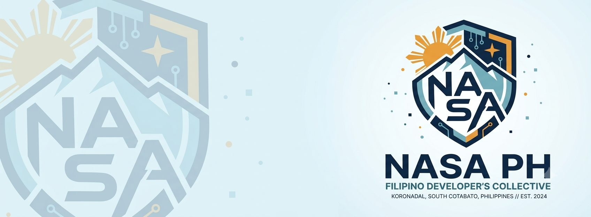
</p>

<!-- 🧑‍💻 Header Typing Animation -->
<p align="center">
  
</p>

<p align="center">
  <a href="http://nasa-ph.com/"></a>
  
  
  
  
</p>


##  About Me

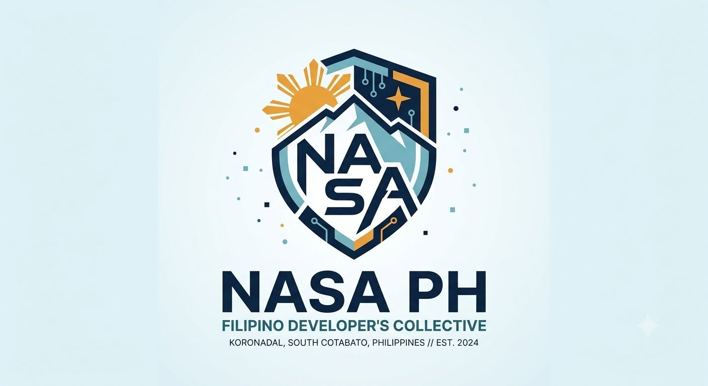

Hi! I'm **John Michael Domingo**, a **Full Stack & Mobile Developer** with **[NASA PH](http://nasa-ph.com/)**, a Filipino developers' collective based in Koronadal, South Cotabato (est. 2024).

I architect end-to-end applications across **web, iOS, and Android**, specializing in the **Next.js / Nest.js** and **Laravel** ecosystems with hands-on **React Native** experience. I work with **Infrastructure as Code (Terraform)** and **CI/CD (GitHub Actions)**, and integrate **RAG, vector databases, and MCP** into production systems on **GCP and AWS**.

- 💼 Full Stack Developer at **ai2aim.ai** (Canada-based)
- 🧠 Architected **Hivemind**, a unified multi-tenant AI platform
- 📦 Shipped **20+ projects** as a freelancer since 2023
- 🔐 Exploring security: pentesting, OWASP Top 10, network security
- 🤖 Into hackathons, robotics & IoT prototypes, and autonomous AI agents

<br clear="right"/>

<details>
<summary><b>⚡ Fun facts (click to expand)</b></summary>
<br/>

```ts
const john = {
  basedIn: "Koronadal City, South Cotabato 🇵🇭",
  collective: "NASA PH — Filipino Developer's Collective",
  dayJob: "Full Stack Developer @ ai2aim.ai",
  currentlyBuilding: ["Hivemind (multi-tenant AI platform)", "RAG pipelines", "MCP integrations"],
  learning: ["Pentesting", "Autonomous AI agents", "DevOps trends"],
  hobbies: ["Hackathons 🏆", "Robotics 🤖", "IoT prototypes 🔌"],
  askMeAbout: ["Laravel", "Next.js", "React Native", "Terraform"],
  funFact: "I turn coffee ☕ into deployed code 🚀",
};
```

</details>

### 💻 `> whoami`

<p align="center">
  
</p>


## 💼 Experience

**Full Stack Developer — [ai2aim.ai](https://ai2aim.ai)** · *Apr 2025 – Present*
- Lead full-stack module development with Express.js and FastAPI
- Automate AWS and GCP resources with Terraform
- Build CI/CD pipelines with GitHub Actions
- Design RAG pipelines and vector search for enterprise clients
- Use MCP to standardize data/tool integrations
- Architected **Hivemind**, a unified AI platform with multi-tenant infrastructure and prompt modules

<p align="center">
  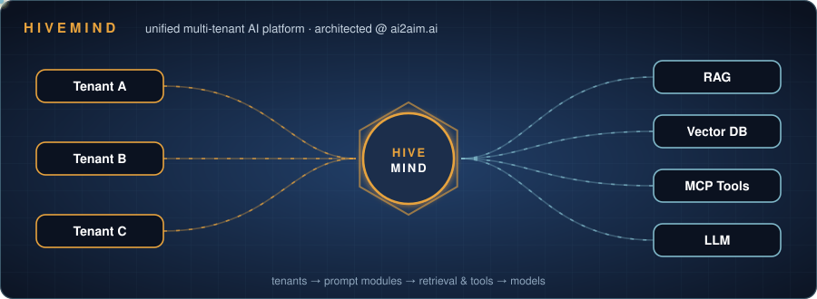
</p>

**Freelance Full Stack & Mobile Developer** · *2023 – 2025*
- Delivered 20+ projects with Next.js, Laravel, and Prisma
- Built cross-platform mobile apps with React Native for iOS and Android
- Developed custom CMS and admin dashboards in Laravel
- Containerized applications with Docker
- Integrated GCP Vertex AI and Supabase into real-time web apps


## 🚀 Tech Stack

<p align="center">
  <a href="https://skillicons.dev">
    
    <br/>
    
  </a>
</p>

<p align="center">
  
</p>


## 🧩 What I Do

<p align="center">
  
</p>


## 🌟 Featured Projects

<p align="center"><i>Click any card to open its source.</i></p>

<p align="center">
  <a href="https://github.com/Laden8210/sakariv-v2"></a>
  <a href="https://github.com/Laden8210/pdl-is"></a>
</p>
<p align="center">
  <a href="https://github.com/Laden8210/weather-forecasting"></a>
  <a href="https://github.com/Laden8210/nasa-social"></a>
</p>
<p align="center">
  <a href="https://github.com/Laden8210/fairmont"></a>
  <a href="https://github.com/Laden8210/dropshipping"></a>
</p>
<p align="center">
  <a href="https://github.com/Laden8210/bmove-2"></a>
  <a href="https://github.com/Laden8210/ybl-backend"></a>
</p>
<p align="center">
  <a href="https://github.com/Laden8210/yolo-app"></a>
  <a href="https://github.com/Laden8210/Thesis-RFID-Borrowing-IMS"></a>
</p>
<p align="center">
  <a href="https://github.com/Laden8210/POS-Project"></a>
  <a href="https://github.com/Laden8210/EPet"></a>
</p>

<p align="center">
  <sub>
    🔗 More links:
    <a href="https://sakarimanagement.com">Sakari (live)</a> ·
    <a href="https://github.com/Laden8210/dropshipping_mobile">Dropshipping Mobile</a> ·
    <a href="https://github.com/Laden8210/Dropshipping_Courier">Dropshipping Courier</a> ·
    <a href="https://github.com/Laden8210/YBL">YBL Mobile</a> ·
    <a href="https://github.com/Laden8210/asl">ASL Recognition</a> ·
    <a href="https://github.com/Laden8210/THESIS-SYSTEM">Thesis System</a> ·
    <a href="http://nasa-ph.com/">more on nasa-ph.com</a>
  </sub>
</p>


## 🕶️ Hacker Mode

<p align="center">
  
</p>

<p align="center">
  
  
  
  
</p>

<p align="center"><i>Breaking things (with permission) so they can be built stronger. 🔐</i></p>

<details open>
<summary><b>😎 Bonus: "Accessing the dark web with prompt engineering"</b> (a parody, nothing is actually hacked)</summary>
<br/>
<p align="center">
  
</p>
</details>


## 🎓 Education & Certifications

- 🎓 **B.S. Information Technology** — STI College Koronadal *(2021 – 2025)*
- 🏫 **Senior High School (HUMSS)** — Koronadal National Comprehensive High School *(2018 – 2021)*
- 🛡️ **Pre Security Certificate** — TryHackMe *(Jun 2026)* · [Credential](https://tryhackme.com/certificate/THM-YJQLKQYGIR)
- 🖥️ **Computer Systems Servicing NC II** — TESDA *(Dec 2025)*


## 📈 GitHub Insights

<p align="center">
  
  
</p>

<p align="center">
  
</p>

<p align="center">
  
</p>

<p align="center">
  
</p>

### 🏙️ 3D Contribution City

<p align="center">
  <picture>
    <source media="(prefers-color-scheme: dark)" srcset="https://raw.githubusercontent.com/Laden8210/Laden8210/output/3d/profile-night-rainbow.svg" />
    <source media="(prefers-color-scheme: light)" srcset="https://raw.githubusercontent.com/Laden8210/Laden8210/output/3d/profile-season-animate.svg" />
    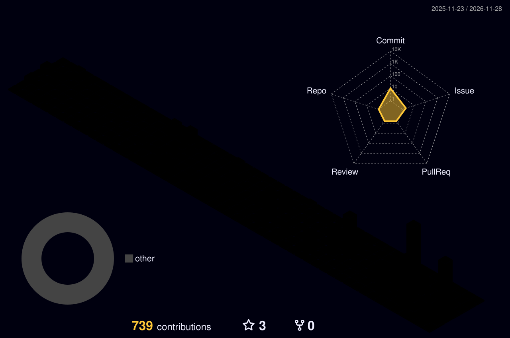
  </picture>
</p>

### 🐍 Contribution Snake

<p align="center">
  <picture>
    <source media="(prefers-color-scheme: dark)" srcset="https://raw.githubusercontent.com/Laden8210/Laden8210/output/github-snake-dark.svg" />
    <source media="(prefers-color-scheme: light)" srcset="https://raw.githubusercontent.com/Laden8210/Laden8210/output/github-snake.svg" />
    
  </picture>
</p>


## 🧠 My Workflow

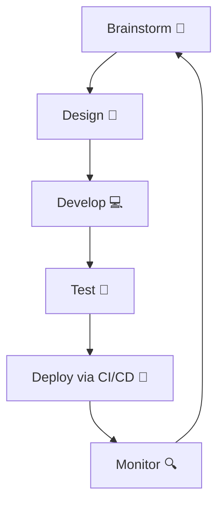


## 🌍 Connect With Me

<p align="center">
  <a href="http://nasa-ph.com/"></a>
  <a href="mailto:domingo.laden@gmail.com"></a>
  <a href="https://www.linkedin.com/in/nasa-ph/"></a>
  <a href="https://www.facebook.com/profile.php?id=61578262636205"></a>
  <a href="https://github.com/Laden8210"></a>
</p>


<p align="center">
  
</p>

<p align="center">
  <i>Built with 💛 in Koronadal, South Cotabato 🇵🇭 · <a href="http://nasa-ph.com/">NASA PH</a></i>
</p>

<!-- 🌊 Animated Wave Footer -->
<p align="center">
  
</p>
